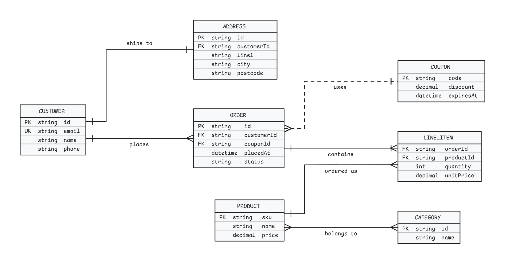

# Merefolk

[](https://community.obsidian.md/plugins/merefolk)
[](https://github.com/quiachonj/merefolk/releases)
[](LICENSE)

Merefolk draws Mermaid ER diagrams in Obsidian as Excalidraw drawings you can
edit. You keep writing a normal `mermaid` block with an `erDiagram`; Merefolk
shows it as a hand-drawn diagram with crow's-foot relationships, and you can
open it in Excalidraw to move things around.

Excalidraw's own Mermaid converter
[doesn't support ER diagrams](https://github.com/excalidraw/mermaid-to-excalidraw/issues/59)
and turns them into a flat image instead.

**Website:** [merefolk.amberlogica.com](https://merefolk.amberlogica.com/) ·
**Support:** [Buy me a coffee](https://buymeacoffee.com/joshquiachon)

<picture>
  <source media="(prefers-color-scheme: dark)" srcset="docs/screenshot-dark.png">
  
</picture>

The diagram above is the first example in
[`test/sample-er.md`](test/sample-er.md), drawn by Merefolk.

## Install

In Obsidian, open **Settings → Community plugins → Browse**, search for
**Merefolk**, then select **Install** and **Enable**. You can also open
[Merefolk in the community plugin directory](https://community.obsidian.md/plugins/merefolk).

Merefolk works on desktop only. It includes Excalidraw, so you don't need the
Excalidraw plugin.

## Usage

1. Write an `erDiagram` in a `mermaid` block:

   ~~~
   ```mermaid
   erDiagram
       CUSTOMER ||--o{ ORDER : places
       ORDER ||--|{ LINE_ITEM : contains
       CUSTOMER {
           string name
           string email PK
       }
   ```
   ~~~

2. Switch to Reading view or Live Preview. The block shows as an Excalidraw
   diagram. It shrinks to fit the note and follows your light or dark theme.

3. Hover the diagram for its buttons. **Open** opens it in an Excalidraw
   canvas. **Copy** copies it as SVG.

4. Edit it in the canvas. Changes save automatically, and the diagram in your
   note shows your edited version from then on.

5. To throw your edits away, click **Re-sync** on the diagram and confirm. The
   diagram is drawn from the Mermaid text again.

The first time you open a diagram, Merefolk adds a line like
`%% merefolk:mhxk2v9q4f1a` right after `erDiagram`. That line links the block to
its saved edits. Mermaid ignores it, so leave it in place.

Until you edit a diagram, it follows the Mermaid text. After you edit it, it
shows your saved version, and changes to the Mermaid text don't show until you
click **Re-sync**.

You can also run the command **"Convert Mermaid ER diagram to Excalidraw"** or
click the **Merefolk: ER → Excalidraw** ribbon icon. They use your selection,
or the `mermaid` block under the cursor, or the only `mermaid` block in the
note. Edits made in a canvas opened this way are not saved.

## Settings

| Setting | What it does | Default |
|---|---|---|
| **Scene folder** | Where saved edits are kept, as a folder path in your vault. Leave it empty for the default. | `.obsidian/merefolk/scenes` |

Changing the folder doesn't move edits you've already saved.

## What's supported

Merefolk reads the common parts of Mermaid's ER syntax:

- Relationships with any cardinality, such as `||--o{`, `}o..o|` or `||--|{`.
  Each one needs a label after `:`. Identifying (`--`) relationships are
  drawn as solid lines and non-identifying (`..`) relationships as dashed
  lines.
- Attribute blocks, one attribute per line: a type, a name, optional `PK`, `FK`
  or `UK` keys separated by spaces, and an optional `"comment"`.
- `%%` comments and `%%{init}%%` directives, which are ignored.

It doesn't read these yet:

- Entity names with anything other than letters, digits and `_`, quoted names,
  or aliases.
- Attribute blocks written on one line, like `A { string id }`.
- Keys separated by commas, like `PK, FK`. Write `PK FK` instead.

If Merefolk can't read a line, it still draws the rest of the diagram and shows
a **⚠** badge with the number of skipped lines. Click it to see them. If it
can't read anything, Obsidian's normal Mermaid render (and its error) is shown
instead. Mermaid diagrams that aren't `erDiagram` are left alone.

## Good to know

- Excalidraw loads its fonts from the internet (unpkg). Without a network
  connection, diagrams may not draw correctly.
- The Excalidraw canvas is in English only.
- A diagram you've edited keeps the colors it had when you edited it. It doesn't
  change when you switch between light and dark themes.
- Saved edits live in your vault's `.obsidian` folder by default. If your sync
  tool skips that folder, your edits won't sync. Point **Scene folder** at a
  regular vault folder if you need them to.

## Contributing

To build from source or change the plugin, see [CONTRIBUTING.md](CONTRIBUTING.md).

## License

MIT © Josh Quiachon / Amberlogica
