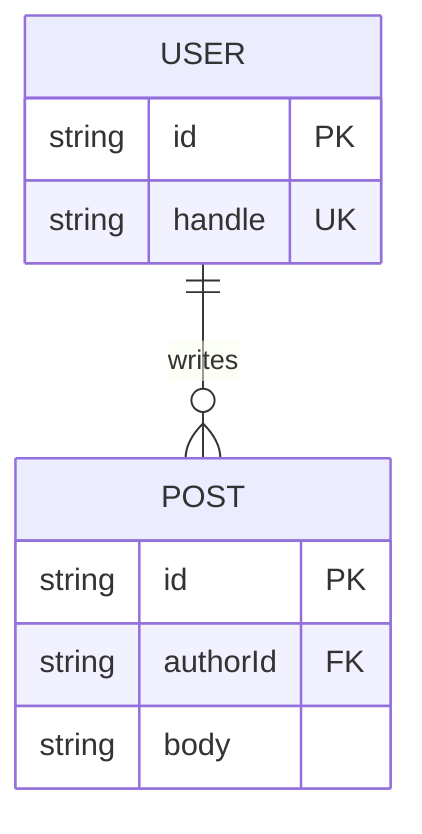

# Sample ER diagram (test fixture)

Open this note in your test vault, select the diagram body inside the
`mermaid` block below (or just run the command with your cursor in the note —
it falls back to the whole file), then run **"Convert selected Mermaid ER
diagram to Excalidraw"**.

This fixture deliberately exercises:

- entity attribute blocks with `PK` / `FK` / `UK` keys and a quoted comment
- all four cardinality glyphs (`||`, `|o`, `o{`, `}o`) on both sides
- identifying (`--`) and non-identifying (`..`) relationships
- a relationship with and without a label

```mermaid
erDiagram
    CUSTOMER ||--o{ ORDER : places
    CUSTOMER ||--o| ADDRESS : "ships to"
    ORDER ||--|{ LINE_ITEM : contains
    PRODUCT ||--o{ LINE_ITEM : "ordered as"
    PRODUCT }o--o{ CATEGORY : "belongs to"
    ORDER }o..o| COUPON : uses

    CUSTOMER {
        string id PK
        string email UK "login identifier"
        string name
        string phone
    }

    ADDRESS {
        string id PK
        string customerId FK
        string line1
        string city
        string postcode
    }

    ORDER {
        string id PK
        string customerId FK
        string couponId FK
        datetime placedAt
        string status
    }

    LINE_ITEM {
        string orderId FK
        string productId FK
        int quantity
        decimal unitPrice
    }

    PRODUCT {
        string sku PK
        string name
        decimal price
    }

    CATEGORY {
        string id PK
        string name
    }

    COUPON {
        string code PK
        decimal discount
        datetime expiresAt
    }
```

## Minimal fixture

A tiny one for quick smoke tests:

