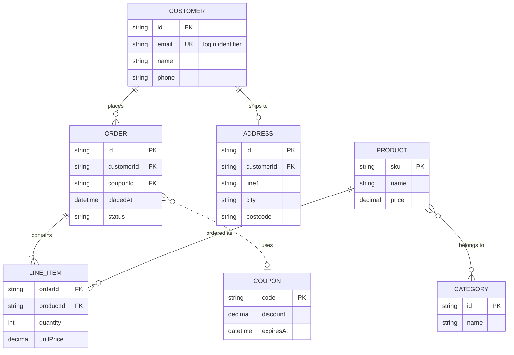
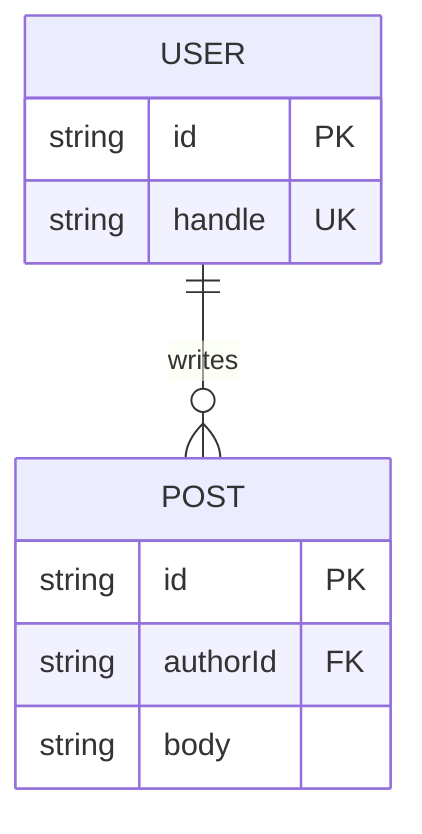
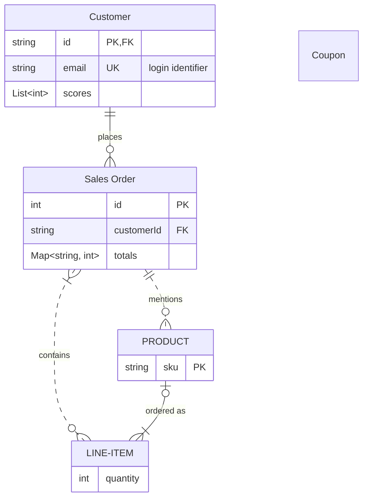
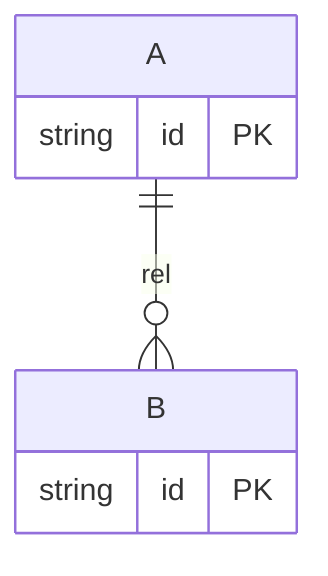
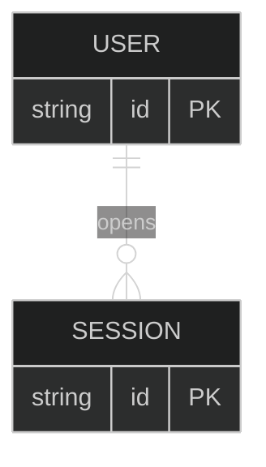
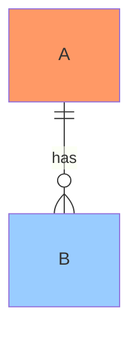
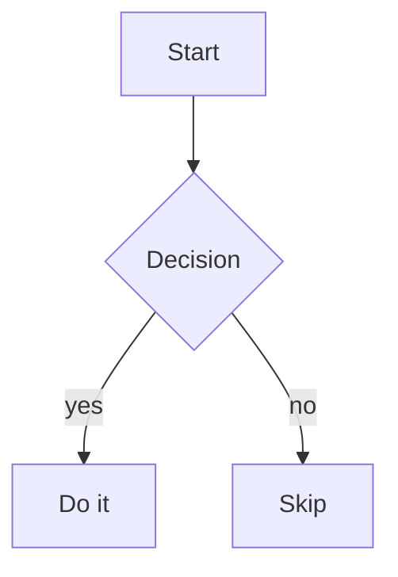

# Sample ER diagram (test fixture)

Open this note in your test vault, in **Reading view** or **Live Preview**. Each
valid `erDiagram` block below should be replaced inline by an Excalidraw render.
Hover a render and check the button group:

- **Open** launches the editable canvas (and writes a `%% merefolk:<id>` line
  right after `erDiagram`); edit something and the inline render updates.
- **Copy** copies the SVG to the clipboard.
- **Re-sync** appears only once the diagram has a saved scene; confirm the
  dialog and the render returns to the Mermaid source.

Second, check the command path: select a diagram body (or put the cursor inside
a `mermaid` block) and run **"Convert Mermaid ER diagram to Excalidraw"**, or
click the **Merefolk: ER → Excalidraw** ribbon icon. The source is the
selection, else the block under the cursor, else the note's only `mermaid`
block (this note has several, so with the cursor outside every block you get a
notice instead). These open a one-off canvas whose edits are not saved.

This fixture deliberately exercises:

- entity attribute blocks with `PK` / `FK` / `UK` keys and a quoted comment
- all four cardinalities: `||` (exactly one), `o|` (zero or one), `o{` / `}o`
  (zero or more) and `|{` (one or more); the left-side forms `|o` and `}|` are
  not exercised
- identifying (`--`) and non-identifying (`..`) relationships
- a relationship with and without a label

The "Mermaid syntax fixture" covers aliases, word cardinalities, comma-separated
keys, generics, one-line blocks and `direction`. The edge cases cover what
isn't read.



## Minimal fixture

A tiny one for quick smoke tests:



## Mermaid syntax fixture

The same syntax Mermaid's own `erDiagram` accepts. **Expected:** no **⚠ badge**
and a top-to-bottom layout (`direction TB`; without a `direction` line Merefolk
lays out left to right). Check:

- `Customer` and `Sales Order` show their aliases in the header, while the
  relationships still connect them by id (`customer`, `order`). `LINE-ITEM`
  keeps its hyphen.
- `string id PK, FK` shows `PK,FK`; `List~int~` shows as `List<int>` and
  `Map~string, int~` as `Map<string, int>`.
- `customer only one to zero or more order` is a solid line with a crow's foot
  (zero or more) at `Sales Order`.
- `order ||.-o{ PRODUCT` and `optionally to` draw dashed lines.
- `PRODUCT` (one-line block) shows one row; `Coupon` (a bare name) is a box
  with just its name.
- The `||` end of the dashed `mentions` line at `Sales Order` is a full, solid
  bar, not a broken one.



## Edge cases (test malformed / unsupported handling)

Each block below exercises a different failure mode. Open this note in
**Reading view** and check the described behavior.

### 1. Malformed relationship → renders partial + ⚠ badge

`AUTHOR |--o{ REVIEW` is missing a bar. **Expected:** renders `AUTHOR`, `BOOK`,
`REVIEW` with the `writes` edge, plus a **⚠ 1** badge (top-left). Click it to see
the skipped line.

```mermaid
erDiagram
    AUTHOR ||--o{ BOOK : writes
    AUTHOR |--o{ REVIEW : receives
    AUTHOR {
        string id PK
        string name
    }
    BOOK {
        string id PK
        string title
    }
    REVIEW {
        string id PK
        int rating
    }
```

### 2. One-line blocks → read, no warning

Mermaid accepts `A { string id PK }` on one line, and so does Merefolk.
**Expected:** boxes `A` and `B` with the edge, each showing one `PK` `string id`
row, and **no ⚠ badge**.



### 3. Unclosed block → recovers, no warning

`ACCOUNT {` is never closed before `TX {`. **Expected:** Merefolk closes the
block and renders both entities fully, with **no ⚠ badge**. (Note: native Mermaid
would error on this; Merefolk recovers leniently.)

```mermaid
erDiagram
    ACCOUNT ||--o{ TX : has
    ACCOUNT {
        string id PK
        string owner
    TX {
        string id PK
        decimal amount
    }
```

### 4. Comments + directives → ignored, no warning

`%%` comments and `%%{init}%%` directives are ignored (not counted as skipped).
**Expected:** clean render, **no ⚠ badge**.



### 5. Totally unparseable → falls back to native Mermaid

No valid entities, so Merefolk bows out and lets Obsidian render the block,
which shows **Mermaid's own error**. **Expected:** a Mermaid error box, no
Merefolk render or buttons.

```mermaid
erDiagram
    this is not valid !!!
    ??? nonsense
```

### 6. Bad attribute line inside a block → only that line is reported

`!!! nonsense` can't be read as an attribute, but the block stays open.
**Expected:** `BOX` shows `id` and `after` (two rows), and the **⚠ 1** badge lists
only `!!! nonsense`. The closing `}` is not reported.

```mermaid
erDiagram
    BOX ||--o{ ITEM : holds
    BOX {
        string id PK
        !!! nonsense
        int after
    }
    ITEM {
        string id PK
    }
```

### 7. Styling → drawn without the style + ⚠ badge

Mermaid styling (`classDef`, `class`, `style`, `:::`) isn't drawn.
**Expected:** both entities and the edge render in the normal colors, plus a
**⚠ 3** badge listing the `classDef`, `class` and `style` lines.



### 8. Non-ER diagram → left alone

A flowchart is valid Mermaid but not an ER diagram, so Merefolk never touches it.
**Expected:** a normal Mermaid flowchart, no Merefolk render or buttons.



